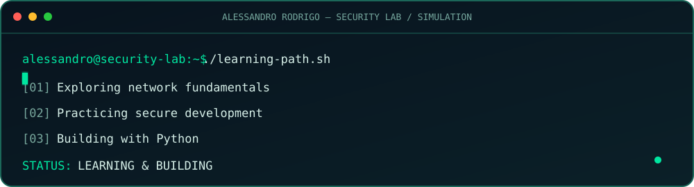

<!-- Cybersecurity profile README -->

  

  

  

<h1 align="center">Alessandro Rodrigo</h1>
<h3 align="center">Análise e Desenvolvimento de Sistemas · Foco em Cibersegurança</h3>

  
  
  

---

## 👨‍💻 Sobre mim

Sou estudante de **Análise e Desenvolvimento de Sistemas (ADS)** e estou direcionando minha formação para **Cibersegurança**.

Tenho interesse em compreender como sistemas, aplicações e redes podem ser protegidos desde sua concepção. Meu objetivo é desenvolver uma base técnica consistente por meio de estudos, laboratórios e projetos práticos.

Acredito que segurança deve fazer parte de todo o ciclo de desenvolvimento do planejamento à manutenção.

## 🎯 Áreas de interesse

- **Application Security (AppSec):** desenvolvimento seguro e análise de vulnerabilidades.
- **Secure Software Development:** práticas de segurança integradas ao ciclo de desenvolvimento.
- **Redes e infraestrutura:** fundamentos de redes, monitoramento e proteção.
- **Automação com Python:** scripts e ferramentas para atividades práticas.
- **Cloud Security:** fundamentos de segurança em ambientes de nuvem.
- **Privacidade:** Privacy by Design e proteção de dados.

## 🧰 Tecnologias e ferramentas em estudo

  

  
  
  

## 🧪 Laboratório e projetos

Este GitHub será meu espaço de prática e evolução, reunindo:

- Projetos acadêmicos e pessoais.
- Scripts de automação e experimentos com Python.
- Estudos sobre redes e segurança.
- Laboratórios, documentações e anotações técnicas.

Os projetos serão documentados conforme forem desenvolvidos e testados, com foco em explicar objetivos, ferramentas, decisões e resultados.

## 📚 Formação e desenvolvimento

- Graduação em Análise e Desenvolvimento de Sistemas.
- Estudos de lógica de programação e Python.
- Aprofundamento em fundamentos de Cibersegurança.
- Interesse em threat modeling, Privacy by Design, SAST e SCA.

## 🤝 Objetivo profissional

Busco uma oportunidade de **estágio em Tecnologia da Informação**, com direcionamento para Cibersegurança, Segurança da Informação ou áreas relacionadas.

Quero aprender com desafios reais, colaborar com responsabilidade e contribuir para a construção de sistemas mais seguros.

---

  Estudando, praticando e construindo conhecimento,um projeto de cada vez.

